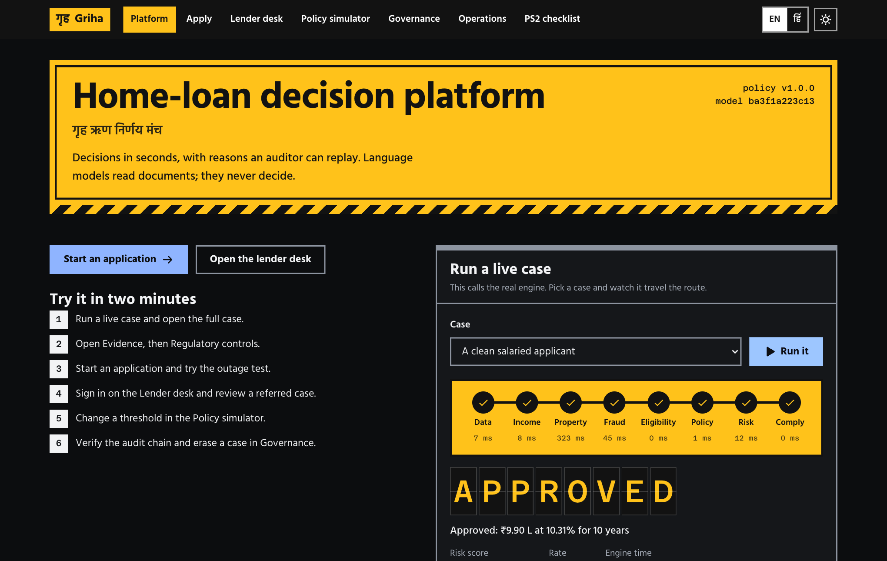
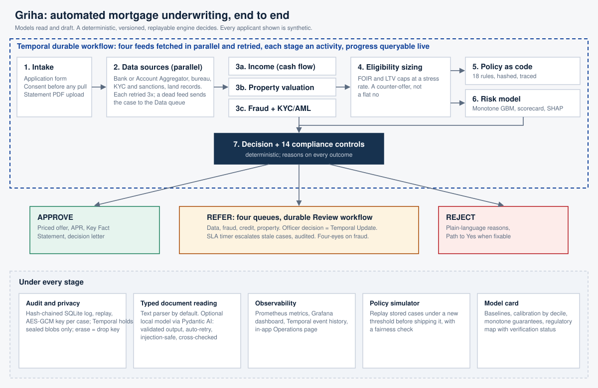

<div align="center">

# गृह · Griha

### Automated mortgage underwriting you can explain, replay and defend to a regulator

Home Loan and Loan Against Property decisions in milliseconds: **approve, reject or refer**, with reasons an auditor can replay, a Key Facts Statement in the RBI's own format, and a compliance trail built from the primary regulatory texts.

[](https://github.com/anshul23102/griha/actions/workflows/ci.yml)
[](LICENSE)


**[Live demo](https://d3l1fg79dbflis.cloudfront.net)** · [Architecture](#architecture) · [Quick start](#quick-start) · [Regulatory coverage](#regulatory-coverage) · [Honest limits](#honest-limits)

*Built for the Hero Housing Fintech Challenge, Problem Statement 2, i-Hack at IIT Bombay E-Summit 2026.*



</div>

> **Read this first.** Every applicant in this project is synthetic. Model metrics describe a simulation, not real borrowers, and one section below shows the checks we ran on real public credit data. Nothing here is a lending product or legal advice. What is real, what is simulated and what is not built is spelled out in [one table](#what-is-real-what-is-simulated-what-is-not-built).

---

## Contents

1. [Why Griha](#why-griha)
2. [What it does](#what-it-does)
3. [Architecture](#architecture)
4. [Quick start](#quick-start)
5. [Configuration](#configuration)
6. [How one decision is made](#how-one-decision-is-made)
7. [The risk model, and evidence outside our own generator](#the-risk-model-and-evidence-outside-our-own-generator)
8. [Regulatory coverage](#regulatory-coverage)
9. [Security and privacy](#security-and-privacy)
10. [Observability and scale](#observability-and-scale)
11. [API reference](#api-reference)
12. [Testing and CI](#testing-and-ci)
13. [Deployment](#deployment)
14. [Repository layout](#repository-layout)
15. [Hackathon requirements, mapped](#hackathon-requirements-mapped)
16. [What is real, what is simulated, what is not built](#what-is-real-what-is-simulated-what-is-not-built)
17. [Honest limits](#honest-limits)
18. [Data sources and licences](#data-sources-and-licences)
19. [Contributing, security reports, licence](#contributing-security-reports-licence)

---

## Why Griha

A home-loan file usually waits days for an officer, and the decision is hard to explain afterwards. Lenders also carry a growing regulatory load: the RBI's Fair Practices Code, Digital Lending, KYC and Responsible Business Conduct Directions, and the DPDP Rules.

Griha is a working answer to one question: **can an underwriting engine be fast, explainable and regulator-aware at the same time, and show its work?**

- **Fast.** Clear cases are decided in about 10 ms of compute. Risky ones go to a person with the evidence already assembled.
- **Explainable.** Every outcome carries reasons, the policy rules that fired, the model's drivers, and a replayable record.
- **Regulator-aware.** The compliance controls cite the paragraph they come from, and each one says how far we verified it. Four regulatory documents were read in their primary text, not from summaries.
- **Honest.** Language models read documents, they never decide. Where something is simulated or not built, the product says so.
- **Free to run.** No paid API, cloud service or data licence is needed anywhere.

## What it does

| Capability | What you get |
|---|---|
| **Instant decision** | Approve, reject or refer for Home Loan and LAP, with an offer, an interest rate set from the RBI repo rate plus a risk premium, and a counter-offer instead of a flat no |
| **Policy as code** | 18 rules in a hashed YAML file, traced line by line on every case; a Policy Impact Simulator replays 1,000 stored applications under a changed threshold before it ships |
| **Risk scoring** | Monotone-constrained LightGBM, isotonic calibration, conformal confidence sets, SHAP drivers, a scorecard band that sets the price |
| **Fraud and KYC/AML** | Statement arithmetic and tamper checks, round-trips, window dressing, linked-applicant graph, anomaly model, real screening against the UN Security Council Consolidated List, an STR signal |
| **Documents** | Bank statements as PDF, or Account Aggregator data in the ReBIT DEPOSIT FI format (XML or JSON); embedded instructions in a document are treated as evidence of tampering, never as commands |
| **Property** | Quantile valuation with a range, comparables, circle rate, title and RERA flags, and the HFC Directions' two-valuation-report rule |
| **Key Facts Statement** | RBI RBC Directions 2025 Annex I layout in **English and Hindi**: proposal number, validity, APR sheet that reproduces the RBI's own worked example (17.07%), amortisation schedule, recorded acknowledgement |
| **Path to Yes** | For a declined or referred case, the smallest change to amount, tenure or co-applicant income that flips the outcome |
| **Humans in the loop** | Four refer queues, an SLA timer that escalates and audits, four-eyes approval for fraud overrides |
| **Governance** | Hash-chained audit log, byte-for-byte replay, tamper detection, per-case encryption with crypto-shredding erasure, model card, drift monitor |
| **Data rights** | Withdraw consent, access, correct, erase (DPDP), a retention hold where the KYC Directions require records, and a personal-data breach register with the 72-hour clock |
| **Operations** | Temporal durable workflows, Prometheus metrics, a provisioned Grafana dashboard, an Operations page |
| **Interface** | "The Reservation Chart" design: Indian Railways station signage, English and Hindi, night and day themes, keyboard navigation, accessibility-tested |

## Architecture

<p align="center"></p>

**Request path.** The React app posts an application to the FastAPI service. In full mode a Temporal `UnderwritingWorkflow` fetches the four data sources in parallel with retries, then runs each stage as an activity. In *inline* mode (the hosted demo) the same stage functions run in one process.

**Stages.** Data, Income, Property, Eligibility, Policy, Risk, Fraud and Compliance, each writing evidence you can open. Stage code lives in `engine.py`; `workflow.py` and `activities.py` only orchestrate it.

**State.** The audit log and the key vault are SQLite in WAL mode. Each decision is an audit entry holding the *encrypted* input, so the case table is a projection of the log and can be rebuilt after a restart. Several worker processes share one database.

**Human review.** A referred case starts a `ReviewWorkflow` that waits for the officer's decision as a Temporal Update, with an SLA timer.

| Layer | Technology |
|---|---|
| Backend | Python 3.11+, FastAPI, Pydantic v2, SQLite (WAL), Temporal, defusedxml |
| Models | LightGBM (monotone constraints), scikit-learn (isotonic, isolation forest), SHAP, conformal prediction |
| Document AI | Deterministic text parser by default; optional local model through a typed Pydantic AI agent |
| Frontend | React 19, Vite 8, Tailwind CSS v4, TypeScript, React Router, Hind and Azeret Mono fonts |
| Observability | Prometheus, Grafana (provisioned dashboard), `prometheus-client` |
| Quality | pytest (133), Playwright with axe accessibility checks (25), bandit, pip-audit, pnpm audit, GitHub Actions |
| Deployment | One Docker image, Caddy for HTTPS, AWS EC2 |

## Quick start

### Option A: just the app (no extra tools)

You need [uv](https://docs.astral.sh/uv/), Node 22+ and [pnpm](https://pnpm.io).

```bash
git clone https://github.com/anshul23102/griha.git
cd griha/backend
uv sync
uv run python -m griha.train 6000        # trains the models into artifacts/ (about 20 s); a trained set is already committed
GRIHA_ORCHESTRATOR=inline uv run uvicorn griha.api:app --port 8000
```

In a second terminal:

```bash
cd griha/frontend
pnpm install
pnpm dev                                  # http://127.0.0.1:5173
```

Without Temporal the API falls back to the in-process engine, and the Operations page says so.

### Option B: the full stack (Temporal, Prometheus, Grafana)

```bash
brew install temporal prometheus grafana  # once; on Linux use each project's installer
GRIHA_API_LIMIT=5000 ops/start.sh         # starts everything and prints the URLs
ops/stop.sh
```

| URL | What |
|---|---|
| <http://127.0.0.1:5173> | The app |
| <http://localhost:8233> | Temporal UI: every case's event history, retries and review timers |
| <http://localhost:3000> | Grafana dashboard (anonymous viewer; admin / `griha-demo`) |
| <http://localhost:9090> | Prometheus |

### Option C: Docker (what the hosted demo runs)

```bash
docker build -t griha .
docker run -p 7860:7860 griha             # http://localhost:7860, inline mode, public-demo banner
```

### Demo sign-ins

| Role | Email | Password |
|---|---|---|
| Officer | `officer@griha.demo` | `griha-demo` |
| Admin (Credit Head) | `admin@griha.demo` | `griha-demo` on a local build. **On the public demo it is private**, given to judges with the submission |

These are demo credentials for synthetic data only. Set `GRIHA_DEMO_PASSWORD` to change the officer password and `GRIHA_ADMIN_PASSWORD` to give the admin its own. When `GRIHA_PUBLIC_DEMO=1` and no admin password is set, the admin account does not exist. The prepared demo cases cannot be erased on the public demo.

### A two-minute tour

1. On the home page, **Run it** on a clean salaried applicant, then open the full case.
2. Open **Evidence**, then **Regulatory controls**. Every control names its paragraph and how far it was verified.
3. Open the **Key Facts Statement**, switch to Hindi, then record the acknowledgement.
4. **Apply**, choose the *flaky bureau* outage test and watch the workflow retry (attempt 3).
5. Sign in on the **Lender desk**, review a referred case, then try to approve a fraud case as the officer (four-eyes blocks it).
6. In the **Policy simulator**, move a threshold and read the fairness table.
7. In **Governance**, verify the audit chain, replay a decision, and erase a case.

## Configuration

| Variable | Default | Purpose |
|---|---|---|
| `GRIHA_ORCHESTRATOR` | `auto` | `auto`, `temporal` or `inline`. `auto` uses Temporal when reachable, else inline |
| `GRIHA_DATA_DIR` | `backend/data` | Audit database, key vault, session key (created with 0600 permissions) |
| `GRIHA_MASTER_KEY` | generated file | URL-safe base64 master key wrapping each case's data key. Set it in production |
| `GRIHA_SECRET` | generated file | Signing secret for sessions and case links |
| `GRIHA_PUBLIC_DEMO` | `0` | `1` shows the public-demo banner and hosted wording |
| `GRIHA_RETENTION_HOLD` | `1` | Keeps records for the KYC retention period before erasure. `0` only where all data is synthetic |
| `GRIHA_SLA_SECONDS` | see `config.py` | Review SLA before escalation |
| `GRIHA_API_LIMIT`, `GRIHA_LOGIN_LIMIT` | see `config.py` | Rate limits |
| `GRIHA_LLM_PROVIDER`, `GRIHA_OLLAMA_MODEL` | off | Optional local document reader (for example `qwen2.5:3b` through [Ollama](https://ollama.com)) |
| `GRIHA_WARM_IMPACT` | `1` | Builds the 1,000-case replay at startup so the first visitor does not wait |
| `GRIHA_DEMO_PASSWORD` | `griha-demo` | Demo officer sign-in password |
| `GRIHA_ADMIN_PASSWORD` | the demo password locally; **required** on the public demo | Admin sign-in password |
| `GRIHA_SEED_DEMO` | `1` on the public demo | Run the ten prepared scenarios on first start |

## How one decision is made

```
Data ─▶ Income ─▶ Property ─▶ Eligibility ─▶ Policy ─▶ Risk ─▶ Fraud + KYC/AML ─▶ Compliance ─▶ Decision
```

| Station | What happens | Failure behaviour |
|---|---|---|
| **Data** | Bank, bureau, KYC and land records fetched in parallel with retries. Account Aggregator or PDF statements are parsed | A source that stays down sends the case to the **Data** queue. Nothing is guessed |
| **Income** | Twelve months of credits become a conservative, verified income; declared income is compared, not trusted | Inflated declared income is flagged; pricing uses verified income |
| **Property** | Quantile valuation with a range, comparables, circle rate, title, RERA and encumbrance flags; two valuation reports above the thresholds | Disagreement or missing reports go to the **Property** queue |
| **Eligibility** | FOIR at a stress rate, tiered LTV caps (90 / 80 / 75% for housing loans), tenure and ticket limits | A smaller counter-offer replaces a flat no |
| **Policy** | 18 hashed rules, each with a reason; the engine version and policy hash are stored with the decision | Hard failures reject; soft ones refer |
| **Risk** | Probability of default with a calibrated range, SHAP drivers, scorecard band, risk-based price | A grey-zone probability, or an uncertain one (a wide upper bound), refers to the **Credit** queue |
| **Fraud and KYC/AML** | Tamper and behaviour checks, UN list screen, PEP and STR signals | A sanctions match goes to an officer, never an automatic decline, and is hidden from the applicant |
| **Compliance** | 15 controls per case, each with clause and verification status (11 shown to the applicant) | Controls that are *enforced* (for example a sanctions match or high-risk onboarding) route the case to an officer; every control is shown with its status |

**"Humanless" does not mean "no human anywhere".** A clean case is decided with no person involved. A person is involved only where the law requires it (a sanctions match, or a rejection that an officer must record: KYC Directions para 18), where a document or title needs checking, or where predicted risk is in a grey zone. On 1,000 synthetic cases the engine decides 62.5% alone (53.8% approved, 8.7% declined) and refers 37.5%: 25.5% to Credit, 5.1% to Fraud and compliance, 4.9% to Property and 2.0% to Data. The home page shows this breakdown.

We tested loosening the thresholds to lift the automatic rate. In the simulation it rises, but so does the default rate among approved loans:

| Eligibility threshold (`min_eligibility_ratio`) | Decided automatically | Realised default rate of approved loans |
|---|---|---|
| 0.60 (shipped) | 62.5% | 3.4% |
| 0.50 | 66.4% | 4.2% |
| 0.40 | 69.8% | 4.9% |

The synthetic labels cannot credit the benefit of a smaller loan, so this overstates the cost of loosening. We still left the limits where they are rather than tune them for the headline number. A lender would set them from its own losses, using the Policy Impact Simulator.

Language models are used only to *read* documents, behind a typed, validated schema, with a cross-check against the PDF text layer. They never score or decide.

## The risk model, and evidence outside our own generator

**Model.** A LightGBM classifier with monotone constraints (a worse debt burden, LTV or delinquency can never lower predicted risk), isotonic calibration, Mondrian conformal sets at 90% target coverage, and native SHAP explanations that feed the written reasons. Twelve inputs; gender, religion and caste are not among them. Age *is* an input (tenure limits need it), and the model card says so.

**On our synthetic test set (720 held-out applicants):** AUC 0.747, KS 0.414, Brier 0.058. A plain logistic regression scores 0.760, so **the boosted model does not beat it here**: the synthetic world is close to linear. We keep the boosted model for its monotone guarantees and SHAP, and the model card says so. See [`docs/model-card.md`](docs/model-card.md).

Because every figure above comes from a generator we wrote, we also ran the **same recipe on two public datasets of real borrowers**, 5-fold out-of-sample:

| Dataset (UCI, CC BY 4.0) | Loans | Logistic | Boosting, free | **Boosting, monotone (ours)** | Calibration gap |
|---|---|---|---|---|---|
| German Credit | 1,000 | 0.782 | 0.793 | **0.788** | 1.1% |
| Taiwan credit-card default | 30,000 | 0.723 | 0.783 | **0.782** | 0.4% |

What this shows: the monotone constraints cost almost no ranking power on real outcomes, and the isotonic probabilities match observed default rates out of sample. What it does *not* show: accuracy on Indian home loans. These are German instalment loans and Taiwanese cards. Reproduce with `cd backend && uv run python -m tools.validate_public` (download the two zip files into `data-external/uci/` first; they are not redistributed here). Results are stored in `backend/artifacts/real_data_validation.json` and shown on the Governance page.

**Fairness.** The simulator reports approval-rate ratios *per attribute* (gender, city tier) with a 95% interval. The four-fifths line is used as a screen: a ratio below 0.80 is only flagged when the whole interval is below it, so small-sample noise is not read as bias. An early reading of 0.794 turned out to be exactly that: on 4,000 cases the ratios are about 0.97 and 0.93.

**Property valuation.** Median absolute percentage error 6.3% on synthetic data; the 80% interval covers 73.9%, *below* its nominal level, so ranges are slightly too narrow. Price levels are synthetic; NHB RESIDEX figures are context only.

## Regulatory coverage

Four regulatory documents were read in their **primary text** (not summaries), and the controls cite the paragraph they come from. Each control is labelled *verified*, *secondary*, *internal* or *unverified*.

| Document | Used for |
|---|---|
| RBI **Housing Finance Companies Directions, 2025** (Chapter X Fair Practices Code, Annexes IV and V) | LTV caps (para 58), KFS disclosures (para 131), valuation reports, grievance route including the NHB cell, foreclosure (para 163), terms sheet |
| RBI **Digital Lending Directions, 2025** | KFS, cooling-off period, grievance escalation, data stored only in India |
| RBI **NBFC KYC Directions, 2025** (RBI/DOR/2025-26/361) | Aadhaar is voluntary, officer records any rejection, high-risk rating for online onboarding, confidentiality of risk category, suspicion and STR (paras 19, 20(4), 52), five-year retention (para 47) |
| RBI **NBFC Responsible Business Conduct Directions, 2025** (RBI/DOR/2025-26/362) | Annex I Key Facts Statement, three-working-day validity, penal charges as a charge not interest (para 30), prepayment (para 34), rate-setting disclosure |
| **DPDP Rules, 2025** (G.S.R. 846(E), corrigendum 892(E), commencement 843(E)) | Notice, security safeguards, breach notification (rule 7), data-principal rights, retention |

**On "NHB regulations".** The brief names the National Housing Bank. Since August 2019 the RBI regulates housing finance companies, and the RBI's *Housing Finance Companies Directions, 2025* are the operative text that replaced the NHB's directions. That is why the controls cite RBI paragraphs. The NHB still runs a complaint redressal cell, and the borrower's letter names it (HFC Directions para 144).

Reading the primary text found and fixed real defects. For example, the applicant's view used to leak sanctions and fraud findings, which would tip off a suspect; a PAN or sanctions failure used to auto-reject instead of going to an officer; erasure ignored the five-year retention duty. A duty-by-duty table with the honest "not built" rows is in [`docs/security.md`](docs/security.md).

**Standard-compliant arithmetic.** Our APR function reproduces the worked example in the RBC Directions (₹20,000 at 15% over 24 months with ₹400 fees gives APR 17.07%, interest ₹3,274). It is a permanent test.

DPDP commencement: rule 4 takes effect on 13 November 2026, rules 3 and 5 to 16 on 13 May 2027.

## Security and privacy

| Asset | Control |
|---|---|
| Applicant data at rest | AES-256-GCM envelope encryption; one random data key per case wrapped by a master key; the audit log stores only ciphertext |
| Data inside the workflow engine | Everything crossing Temporal is sealed under the case key with a purpose tag, so the workflow history holds ciphertext |
| Right to erasure | Crypto-shredding: destroying the case key makes stored input and workflow history unreadable while the hash chain still verifies. A retention hold defers it where the KYC Directions require records |
| Who can open a case | A per-case capability key (in the link fragment, never sent in a URL query) or a staff login. A case link without its key is a plain "not found" |
| What the applicant may see | Fraud findings, sanctions matches, STR signals, the risk category and officer notes are removed from their view (KYC paras 19, 20(4), 52) |
| Authentication | HMAC bearer tokens, per-user salted PBKDF2 (600k), account lockout, logout revocation |
| Input handling | Strict schemas, sanitised 422s that never echo input, control and bidi characters rejected, DTD and entity XML rejected, size caps |
| Prompt injection | Instructions inside a document are treated as tamper evidence and never reach a decision |
| Transport and headers | HSTS and related headers; a hash-pinned content security policy on the hosted build |
| Backups | `python -m griha.backup`: verified hash chain, 0700 / 0600 permissions, master key excluded |
| Supply chain | `bandit`, `pip-audit` and `pnpm audit` run in CI |

Full control list, tests and limits: [`docs/security.md`](docs/security.md). To report a vulnerability, see [`SECURITY.md`](SECURITY.md).

## Observability and scale

- **Metrics:** decisions, stage latency, fraud flags, rule hits, retries, SLA escalations and model calls are exported to Prometheus and shown in a provisioned Grafana dashboard (13 panels) and the Operations page.
- **Drift:** Population Stability Index of live inputs against the training reference, once at least 100 distinct applicants exist.
- **Measured throughput** (`backend/tools/loadtest.py`, synthetic cases, no bureau latency): laptop 53 to 68 decisions a second with one worker, about 133 with two and 185 with four, zero errors, one intact hash chain; a 1 GB t3.micro runs one worker at 7 to 15 a second. A 120-second sustained run on the laptop completed 13,718 decisions with no errors and 20 KB of storage per decision. The load test found three real bugs, now fixed.
- **Not claimed:** one million decisions a day. [`docs/scalability.md`](docs/scalability.md) shows the arithmetic and the limits.
- **Business impact panel:** measured (straight-through rate, engine time) is separated from assumed (officer minutes and cost), and the assumptions are editable.

## API reference

Interactive OpenAPI docs are served at `/docs` (the hosted demo allows the Swagger CDN on that one page only). `POST /api/applications/new` accepts an `Idempotency-Key` header: a double click or retry returns the first case instead of creating a second. Main routes:

<details>
<summary><b>Applicant and case routes</b></summary>

| Method | Route | Purpose |
|---|---|---|
| POST | `/api/applications/new` | Submit a real form; returns the decision and a private case key |
| POST | `/api/applications` | Run a prepared scenario |
| GET | `/api/cases/{id}` | The case (applicant view needs the case key; staff see everything) |
| GET | `/api/cases/{id}/progress` | Live stage progress from the workflow |
| GET | `/api/cases/{id}/schedule` | Amortisation schedule |
| POST | `/api/cases/{id}/retry`, `/path-to-yes` | Re-run with changes; find the smallest change that flips the outcome |
| POST | `/api/cases/{id}/kfs-ack` | Record the borrower's acknowledgement of the KFS |
| POST | `/api/cases/{id}/rights` | Withdraw consent, access, correct, erase (DPDP) |
| POST | `/api/documents/statement`, `/api/documents/aa` | Upload a PDF statement or an Account Aggregator file |
| POST | `/api/eligibility` | "What can I borrow" calculator |
| GET | `/api/reference`, `/api/scenarios`, `/api/samples/...` | Reference data and synthetic samples |

</details>

<details>
<summary><b>Lender and governance routes (sign-in required)</b></summary>

| Method | Route | Purpose |
|---|---|---|
| POST | `/api/login`, `/api/logout` | Session |
| GET | `/api/cases` | The case chart |
| POST | `/api/cases/{id}/review` | Officer decision (four-eyes on fraud) |
| POST | `/api/cases/{id}/erase` | Crypto-shred a case (admin) |
| POST | `/api/simulate` | Policy Impact Simulator |
| GET | `/api/audit/verify` | Verify the hash chain |
| POST | `/api/audit/replay/{id}`, `/tamper-demo/{id}` | Replay a decision; demonstrate tamper detection |
| GET, POST | `/api/breaches`, `/api/breaches/{ref}/notify` | Breach register (admin) |

</details>

<details>
<summary><b>Public information routes</b></summary>

| Method | Route | Purpose |
|---|---|---|
| GET | `/api/health`, `/api/stats`, `/api/ops`, `/api/metrics` | Health, public counters, operations, Prometheus |
| GET | `/api/policy`, `/api/model-card`, `/api/sources`, `/api/impact`, `/api/benchmark` | Policy, model card with real-data check, data sources, business impact, capacity |

</details>

## Testing and CI

```bash
cd backend && uv run pytest -q            # 133 tests; the Temporal tests boot their own dev server and skip if the CLI is absent
cd frontend && npx tsc -b                 # the real typecheck
cd frontend && GRIHA_API_LIMIT=5000 ../ops/start.sh && pnpm e2e   # 25 browser tests with axe accessibility checks
```

What the tests cover, beyond the obvious: byte-for-byte replay and tamper detection, crypto-shredding, retention deferral, applicant-view redaction, the APR example from the RBI, Annex I structure, Hindi/English parity of the KFS, per-attribute fairness statistics, a real UN-list hit end to end, the breach clock, XML hardening, prompt-injection handling, multi-worker consistency, and a real Temporal server.

GitHub Actions ([`ci.yml`](.github/workflows/ci.yml)) runs on every push: backend tests, a bandit scan, `pip-audit`, the frontend typecheck, build and `pnpm audit`, and a Docker build that starts the container and checks `/api/health`.

## Deployment

The hosted demo is one Docker container on a small AWS EC2 instance, with Caddy providing HTTPS, and its data on a named Docker volume so a redeploy keeps cases and private links. On first start it runs the ten prepared synthetic scenarios through the engine, so the desk and the live numbers are not empty. It runs inline (no Temporal or Grafana), with synthetic data only. A case rebuilt after a policy or engine change is marked as such rather than silently showing a different decision. The Operations page shows recorded screenshots of the full stack. Step-by-step instructions, backup and retention are in [`docs/deploy.md`](docs/deploy.md).

```bash
ops/deploy-vm.sh <public-ip> ~/.ssh/<key>.pem
```

The hosted copy runs in Sydney. A production deployment must keep data in India (Digital Lending Directions para 13(iv)).

## Repository layout

```
backend/
  griha/            engine, stages, policy, risk, fraud, compliance, pricing (+ Hindi KFS), audit, crypto,
                    sanctions (UN list), aa (ReBIT), docextract, redact, backup, API, Temporal workflow
  policy/v1.yaml    18 rules and the regulatory map, hashed into every decision
  artifacts/        trained models, metrics, real-data validation
  tools/            loadtest, validate_public (real data), validate_freddie (local only)
  tests/            133 tests
frontend/           React app, Playwright e2e and screenshot scripts
ops/                start/stop scripts, Prometheus and Grafana config, VM deploy script
docs/               architecture, model card, security, scalability, deploy, data licensing, design spec, video script
PRODUCT.md, DESIGN.md   who it is for and the visual system
```

## Hackathon requirements, mapped

The brief for Problem Statement 2 asks for eight capabilities. The in-app **PS2 checklist** page lists, for each, where to see it, what was measured and the honest limit.

| # | Requirement | Where |
|---|---|---|
| 1 | Integrate data sources | Four adapters with channel, time and records per case; PDF and ReBIT Account Aggregator parsing; outage handling |
| 2 | Eligibility and policy | FOIR and LTV sizing, 18 hashed rules, counter-offers, instant calculator |
| 3 | Fraud and KYC/AML | `fraud.py`, `sanctions.py` (real UN list), STR signal, entity graph |
| 4 | Risk scoring | `risk.py`: monotone LightGBM, calibration, conformal sets, SHAP, scorecard |
| 5 | Documents and property | `docextract.py`, `aa.py`, `property.py` |
| 6 | Compliance checks | `compliance.py` (15 controls per case) and the regulatory map |
| 7 | Instant decision | `engine.py`, about 10 ms median compute per case |
| 8 | Explainability and governance | Reasons, evidence, replay, hash-chained audit, model card, human review |

Judging criteria and where each is addressed: accuracy and feasibility (model card, real-data check), use of data (data sources page), explainability (reasons, replay, Path to Yes), regulatory fit (primary-text controls, Annex I KFS), scalability (load test, workflows), clarity (checklist page, this README).

## What is real, what is simulated, what is not built

| Real | Simulated (shaped like the real feed) | Designed for, not built |
|---|---|---|
| APR calculation (matches the RBI worked example); KFS in the RBC Annex I layout, English and Hindi; RBI repo rate and NHB RESIDEX figures; UN sanctions screening; ReBIT Account Aggregator file parsing; hash-chained audit; encryption and crypto-shredding; DPDP data-rights flow and breach register | Bureau, KYC and land-record feeds; applicants; the Account Aggregator link itself; property price levels | AA consent flow and FIU signing; OFAC, EU, UK and MHA lists; PEP data; CKYCR upload; video KYC; address confirmation; quarterly borrower statements; document release; recovery-agent rules; Postgres; India-region hosting |

## Honest limits

- **No Indian loan-level data we could use.** (The public sets we found are listed, with reasons, as rejected on the Data sources page.) Accuracy on Indian borrowers is unknown, and the synthetic default rate is several times the real Indian housing NPA ratio (about 0.5% for banks at March 2026, a figure from press reports of the RBI's June 2026 Financial Stability Report that we have not checked against the RBI text). A lender must retrain and re-set the cut-offs on its own loans: `python -m griha.byod --csv book.csv` validates the file, retrains the same monotone calibrated model, reports out-of-sample AUC, KS and calibration, and writes a separate artifact set; the shipped model is never overwritten. A private local check on US mortgage data exists and is deliberately not published, pending the data provider's written confirmation.
- **Policy cut-offs are illustrative** (FOIR, age, bureau, probability-of-default). The LTV caps are from the HFC Directions. Items only a lender can supply, such as the penal-charge amount, reset frequency and grievance officer, appear as "Lender to state". They are never invented.
- **Hindi text is unreviewed.** The Hindi KFS and privacy notice were written for this prototype. The DPDP terms follow the Hindi text of the Gazette; the RBI terms are our own choices. [`docs/hindi-review.md`](docs/hindi-review.md) lays every sentence beside its English with a glossary, and the app only stops saying "unreviewed" when a named, qualified reviewer signs `backend/griha/data/hindi_review.json`.
- **Sanctions coverage is the UN list only.** OFAC, EU, UK and MHA lists and PEP data need a licensed feed.
- **The breach register tracks the three notices; it does not send them.**
- **Scale is measured, not proven.** Throughput numbers are from a laptop and a 1 GB server, on bursts and one sustained run.
- **The hosted demo is in Sydney, in one process.** It carries synthetic data only. The AWS free plan is locked to the region it was created in, so a move to India needs a paid plan or another provider; `docs/deploy.md` has the steps for when one is available.
- **The local document-reading model is slow** (about 20 tokens a second on an 8 GB laptop) and optional; the text parser is the default.

## Data sources and licences

The **Data sources** page (`/sources`, `GET /api/sources`) lists every figure the product relies on with publisher, date, link and status: real published figures (RBI repo rate 5.50% from the October 2026 MPC minutes; NHB RESIDEX Q3 FY2025-26), synthetic data, our own assumptions, and sources we looked at and rejected, with reasons.

| Source | Use | Licence |
|---|---|---|
| UN Security Council Consolidated List | Sanctions screening (snapshot in `backend/griha/data/`) | Public; refresh with `python -m griha.sanctions --refresh` |
| UCI German Credit (doi:10.24432/C5NC77), Taiwan card default (doi:10.24432/C55S3H) | Real-data validation only; not included in the repository | CC BY 4.0 |
| RBI and MeitY regulatory texts | Read for the controls; not included in the repository | Public documents |
| ReBIT Account Aggregator schema | Format of the AA adapter | Public specification |
| Freddie Mac loan-level sample | A private local check, never trained on, never published | Licence forbids redistribution; see [`docs/data-licensing.md`](docs/data-licensing.md) |

## Contributing, security reports, licence

Issues and pull requests are welcome; see [`CONTRIBUTING.md`](CONTRIBUTING.md). Report vulnerabilities privately as described in [`SECURITY.md`](SECURITY.md). Released under the [MIT licence](LICENSE); third-party data keep their own licences.

<div align="center">

*Griha means "home". Built for the Hero Housing Fintech Challenge, i-Hack, IIT Bombay E-Summit 2026.*

</div>
